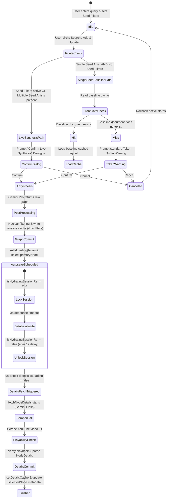

# Zcene Engine & Production Architecture

This document outlines the core technical architecture, interface boundaries, and data pipelines of the Zcene music discovery platform.

---

## 1. System Boundaries & Layered Architecture

Zcene is structured as a serverless, decoupled application with three primary architectural layers: the **Frontend UI Client**, the **Secure Backend Proxy Gateway**, and the **Database/Storage Layer**.

```
┌────────────────────────────────────────────────────────────────────────┐
│                          FRONTEND UI CLIENT                            │
│                 (React / Vite SPA • D3.js Force Physics)               │
└───────────────────┬────────────────────────────────┬───────────────────┘
                    │                                │
      Secure API Proxy Requests                      │ Firebase SDK Operations
    (Authentication & Gemini Proxies)                │ (Auth / Firestore Writes)
                    ▼                                ▼
┌────────────────────────────────────────┐ ┌─────────────────────────────┐
│          BACKEND PROXY GATEWAY         │ │   DATABASE/STORAGE LAYER    │
│    (Node.js / Express Container on     │ │  (Cloud Firestore Database  │
│         Google Cloud Run)              │ │   & Cloud Storage Assets)   │
└───────────────────┬────────────────────┘ └─────────────────────────────┘
                    │
      API Key Injected (x-goog-api-key)
                    ▼
┌────────────────────────────────────────┐
│           GEMINI API BACKEND           │
│     (Google language API endpoints)    │
└────────────────────────────────────────┘
```

### 1.1 Frontend UI Client (React / Vite SPA)
The client edge operates as a Single Page Application (SPA) responsible for interactive layouts, physics simulations, and local state management.
*   **Physics Simulation:** Powered by a customized `d3-force` model tuned for stable organic clustering (implemented in `MusicGraph.tsx` and `ExampleMusicGraph.tsx`). Velocity decay is set to `0.7`, and sticky drag operations pin coordinates (`fx`/`fy`) for curated persistence.
*   **Resilience & Rate Limiting:** Implements sequential queueing (1-at-a-time fetches) and exponential backoff to handle free-tier Gemini API limitations (15 RPM) gracefully without UI disruption.
*   **Client-Side Verification ("Nuclear Option"):** A post-processing pipeline in `App.tsx` manually filters and prunes LLM outputs. It strips out artists violating geographical/era search filters and prunes orphaned links where source or target nodes are missing.
*   **Security Gating:** Gated pages (such as the `EnginePage` and `StyleGuidePage`) are lazy-loaded via dynamic bundle-splitting (`React.lazy`) and rendered only to authorized accounts (e.g. admin accounts) to prevent public code discovery.
*   **Token Confirmation Interceptor:** Intercepts net-new generation flows (graph creation queries), node expansions (graph extensions), and individual node clicks (Deep Cut biography creation) for uncached artists. It also intercepts clicks on cached profiles that fail data quality heuristics (such as case-insensitive substring checks for missing field indicators like `unknown`, `n/a`, `none`, `null`, `undefined`, `placeholder`, `not available` across all core fields; purely lowercase identifier markers on labels, details, or inside the bio's first bolded markdown token like `**scowl**`; syntax leaks; or repeating template placeholder paragraphs like `"is a notable music entity"`) using the `data_quality_optimization` warning. It displays a design system-compliant warning dialog showing cost metrics mapped directly from the platform Usage Analytics ledger.
*   **Smart Cancel Fallback Routing & Quality Gate Interception:** On a partial cache hit for multi-artist queries, if the user cancels the token warning dialog, the system automatically strips out the uncached subset and re-routes using only the cached subset of artists. If a quality gate interception is triggered for a node click, a "Cancel" action cleanly aborts the selection timeline entirely without changing the active sidebar selection, while a "Confirm" action triggers cache eviction (both local and Firestore) and queues a fresh live AI synthesis.
*   **Sandbox Short-Circuiting:** Enforces complete API short-circuiting by bypassing outbound HTTP dispatches to the Gemini proxy gateway with local static JSON payloads and mock generators to prevent billable consumption.
*   **Platform Optimizations:** Acquires a sentinel using the browser `Screen Wake Lock API` during active AI generations to prevent mobile devices from sleeping and suspending the background processes.
*   **Taste Profile & Compatibility Meter:** A client-side visual compatibility gauge is calculated deterministically on the client using the active user's taste filters (Genre, Origin, and Era range) without any AI API key overhead or external requests, ensuring lightning-fast layout updates.

### 1.2 Backend Proxy Gateway (Cloud Run Container)
A lightweight Node.js Express server (`server.js`) deployed on Google Cloud Run acts as a secure reverse proxy and static asset server.
*   **Static Assets:** Serves the compiled SPA production assets from the local `/dist` directory.
*   **Gemini API Proxy (`/api/gemini`):** Intercepts client language model requests, removes the route prefix, and forwards requests to `generativelanguage.googleapis.com`. The pipeline operates as a two-stage Express middleware chain designed to prevent 401 unauthenticated gateway errors:
    *   **Pre-Proxy Sanitization Middleware (Stage 1):** A dedicated Express middleware executes *before* the `http-proxy-middleware` loop. It cleanses the incoming request at the Express layer, ensuring the proxy agent never receives contaminated client-session data.
    *   **Rogue Header Extraction:** Within this sanitization stage, the middleware explicitly deletes both the `authorization`/`Authorization` and `cookie`/`Cookie` headers from the incoming request object. This prevents Firebase Hosting identity credentials and browser session cookies from leaking into the outbound request and polluting Google's API gateway edge.
    *   **Secure Token Injection (Stage 2):** The `http-proxy-middleware` is configured with a `proxyReq` lifecycle hook. Once the outbound request packet is clean, the server-side `GEMINI_API_KEY` is securely appended as the `x-goog-api-key` header, guaranteeing authenticated access to the Gemini API without ever exposing the key to the client.
*   **Auth Proxy (`/__/auth`):** Proxies Firebase Auth handler requests to the target Firebase domain (`firebaseapp.com`) to avoid cross-origin domain restrictions.

### 1.3 Database/Storage Layer (Firebase & Google Cloud Storage)
*   **Firebase Authentication:** Handles secure Google OAuth popup workflows, populating authenticated tokens for client authorization.
*   **Firestore Database:** A document-oriented database partitioned under strict Attribute-Based Access Control (ABAC) rules:
    *   **User Profiles (`/users/{userId}`):** Personal preferences, authorization overrides, and onboarding state.
    *   **Projects (`/users/{userId}/projects/{projectId}`):** Holds user-specific workspaces. Projects store seed artists, active node arrays, chat logs, filters, and a lightweight `canvasLayout` (a JSON array of nodes and their customized coordinate vectors: `{nodeId, x, y, fx, fy}`). Heavy graph representations are decoupled.
    *   **Global Artist Cache (`/artists/{cacheKey}`):** Stores isolated subgraphs (extracted via `extractArtistSubGraph`) and curated node details. Security rules allow read access to all users, write access (`create`) only on cache misses, and patch access (`update`) restricted solely to the `detailsCache` (Deep Cuts details) and `hitCount` (analytics) fields to prevent graph poisoning.
    *   **Public Shares (`/sharedZcenes/{shareId}`):** Publicly readable read-only graphs that are write-gated to their authenticated authors.
*   **Google Cloud Storage (GCS):** Serves static high-fidelity page backdrops and visual cards via secure HTTPS endpoint paths:
    *   `https://storage.googleapis.com/zcene-prod-assets/Zcene%20general%20background.jpeg` (Main UI background, graph canvas background, details panel base).
    *   `https://storage.googleapis.com/zcene-prod-assets/Artist%20background.png` (Artist bio features/panels background).
    *   `https://storage.googleapis.com/zcene-prod-assets/Deep%20Cut%20background.png` (Deep Cut details panel background and Collection Intelligence visual background).

---

## 2. Project Creation, Mapping, & Hydration Pipeline

This sequence diagram illustrates the lifecycle of a newly created Zcene project—from initial empty instantiation, cloud asset hydration, cache lookup, model orchestration, post-processing validation, and detail enrichment.

### 2.1 Sequence Diagram

```
User (Browser)          Frontend UI          Firestore DB          Cloud Storage (GCS)       Backend Proxy        Gemini API
   │                         │                     │                       │                       │                   │
   ├─► Click "Create Project"│                     │                       │                       │                   │
   │   (Dashboard.tsx)       │                     │                       │                       │                   │
   │                         ├─► Generate UUID     │                       │                       │                   │
   │                         │   Reset local state │                       │                       │                   │
   │                         │                     │                       │                       │                   │
   │                         ├─────────────────────┼───────────────────────┼───────────────────────┼───────────────────┤
   │                         │ PHASE 01: INITIAL PROJECTS INITIALIZATION & BACKGROUND ASSETS HYDRATION                     │
   │                         ├─────────────────────┼───────────────────────┼───────────────────────┼───────────────────┤
   │                         │                     │                       │                       │                   │
   │                         ├─► setDoc() ────────►│                       │                       │                   │
   │                         │   (users/{uid}/     │                       │                       │                   │
   │                         │    projects/{id})   │                       │                       │                   │
   │                         │                     │                       │                       │                   │
   │                         ├─► GET general bg ──────────────────────────►│                       │                   │
   │                         │   (Zcene general background.jpeg)           │                       │                   │
   │                         │◄────────────────────────────────────────────┤                       │                   │
   │                         │   Renders Canvas & UI Backdrop              │                       │                   │
   │                         │                     │                       │                       │                   │
   │                         ├─────────────────────┼───────────────────────┼───────────────────────┼───────────────────┤
   │                         │ PHASE 02: CACHE VERIFICATION & ORCHESTRATION                                            │
   │                         ├─────────────────────┼───────────────────────┼───────────────────────┼───────────────────┤
   │                         │                     │                       │                       │                   │
   │   Enter Seed Artists    │                     │                       │                       │                   │
   ├─► Click "Search" ──────►│                     │                       │                       │                   │
   │   ("Band A::Band B")    ├─► readArtistCache() │                       │                       │                   │
   │                         ├─► (artists/{slug}) ─►                       │                       │                   │
   │                         │◄── [CACHE MISS] ────┤                       │                       │                   │
   │                         │                     │                       │                       │                   │
   │                         │   Invoke API ──────────────────────────────────────────────────────►│                   │
   │                         │   (POST /api/gemini)                                                │                   │
   │                         │                                                                     ├─► Inject Key      │
   │                         │                                                                     │   Forward Request │
   │                         │                                                                     ├──────────────────►│
   │                         │                                                                     │   (gemini-3.1-pro)│
   │                         │                                                                     │                   │
   │                         │                                                                     │◄── Return JSON ───┤
   │                         │                                                                     │    (Graph Nodes)  │
   │                         │◄── Return raw JSON ─────────────────────────────────────────────────┤                   │
   │                         │                     │                       │                       │                   │
   │                         ├─────────────────────┼───────────────────────┼───────────────────────┼───────────────────┤
   │                         │ PHASE 03: POST-PROCESSING, WRITING TO CACHE & CANVAS CONVERGENCE                        │
   │                         ├─────────────────────┼───────────────────────┼───────────────────────┼───────────────────┤
   │                         │                     │                       │                       │                   │
   │                         ├─► Nuclear Filtering │                       │                       │                   │
   │                         │   Orphan Link check │                       │                       │                   │
   │                         │                     │                       │                       │                   │
   │                         ├─► writeArtistCache()│                       │                       │                   │
   │                         │   (extract subgraphs│                       │                       │                   │
   │                         │    set artists/{id})│                       │                       │                   │
   │                         ├────────────────────►│                       │                       │                   │
   │                         │                     │                       │                       │                   │
   │                         ├─► Initialize D3 ───►│                       │                       │                   │
   │                         │   Simulation        │                       │                       │                   │
   │                         │   (Dynamic physics) │                       │                       │                   │
   │                         │                     │                       │                       │                   │
   │                         ├─────────────────────┼───────────────────────┼───────────────────────┼───────────────────┤
   │                         │ PHASE 04: DETAIL ENRICHMENT (DEEP CUTS)                                                 │
   │                         ├─────────────────────┼───────────────────────┼───────────────────────┼───────────────────┤
   │                         │                     │                       │                       │                   │
   │   Select Node           │                     │                       │                       │                   │
   ├─► Click Artist Node ───►│                     │                       │                       │                   │
   │                         ├─► fetchNodeDetails()│                       │                       │                   │
   │                         │   (Check Cache) ───►│                       │                       │                   │
   │                         │◄── [DETAILS MISS] ──┤                       │                       │                   │
   │                         │                     │                       │                       │                   │
   │                         │   Invoke Details API ──────────────────────────────────────────────►│                   │
   │                         │   (POST /api/gemini)                                                │                   │
   │                         │                                                                     ├─► Inject Key      │
   │                         │                                                                     │   Forward Request │
   │                         │                                                                     ├──────────────────►│
   │                         │                                                                     │   (gemini-3-flash │
   │                         │                                                                     │    + Web Search)  │
   │                         │                                                                     │                   │
   │                         │                                                                     │◄── Return JSON ───┤
   │                         │                                                                     │    (Bio Summary)  │
   │                         │◄── Return raw JSON ─────────────────────────────────────────────────┤                   │
   │                         │                     │                       │                       │                   │
   │                         ├─► GET panel assets ────────────────────────►│                       │                   │
   │                         │   (Artist/Deep Cut backgrounds)             │                       │                   │
   │                         │◄────────────────────────────────────────────┤                       │                   │
   │                         │   Renders Enriched Detail Bio Card          │                       │                   │
   │                         │                     │                       │                       │                   │
   │                         ├─► updateDoc() ─────►│                       │                       │                   │
   │                         │   (Save bio back    │                       │                       │                   │
   │                         │    to artists/{id}) │                       │                       │                   │
   v                         v                     v                       v                       v                   v
```

### 2.2 Functional Walkthrough

1.  **Phase 01: Project Creation & Static Hydration:**
    *   The user initiates a project creation, prompting the frontend to generate a unique `projectId` and clear any active graph states.
    *   The frontend initiates an asynchronous document write (`setDoc`) to `/users/{userId}/projects/{projectId}`.
    *   Concurrently, the UI imports and paints its visual backdrop layers by requesting background assets (`Zcene general background.jpeg`) from GCS via direct HTTP paths.
2.  **Phase 02: Verification & AI Orchestration:**
    *   Once a user commits seed input, the application checks Firestore's `/artists` path via a multi-get operation (`readArtistCacheMany`) to query normalized artist IDs.
    *   If a cache hit occurs, the cached nodes and links are returned, bypassing step 3.
    *   On a cache miss (or partial hit), the frontend intercepts the flow and triggers the **Token Confirmation Dialog** displaying the estimated query cost ($0.0015/query) and splitting the inputs into cached and synthesis-required badges.
    *   On cancellation of a partial hit, the pipeline filters out the uncached subset of artists and automatically re-routes using the cached subset. If the query has no cached subset or is canceled, the loading state is rolled back and the flow halts, cleanly resetting active states to prevent canceled entries from leaking into the slider stack. If the user confirms, the frontend formats a request containing the prompt, response schema requirements, and user filters, transmitting it to `/api/gemini` (which is completely short-circuited with a static JSON payload in sandbox configurations).
    *   The Cloud Run proxy intercepts live requests and routes them through the two-stage sanitization pipeline: a pre-proxy Express middleware first strips the incoming `authorization` and `cookie` headers (preventing Firebase credential leaks from triggering 401 errors at Google's API gateway edge), then the `proxyReq` hook injects the server-side `x-goog-api-key` token into the now-clean outbound packet before redirecting to the Google Gemini service executing `gemini-3.1-pro-preview`.
3.  **Phase 03: Post-Processing, Writing to Cache, and Physics convergence:**
    *   Once the model responds with structured JSON, the frontend filters out any nodes that violate era or origin criteria.
    *   The pruned sub-graphs are separated by artist and pushed asynchronously to Firestore under `/artists/{cacheKey}` with an initialized `hitCount: 0`.
    *   The compiled graph is loaded into the React state. The D3 force engine initializes physics nodes, applies momentum constraints (`velocityDecay: 0.7`), and converges the simulation. If a project is loaded, coordinate positions are read from `canvasLayout` and pinned.
4.  **Phase 04: Detail Enrichment (Deep Cuts):**
    *   When the user selects an artist node (on map click, My Stack details navigation, or related Scene Circle click), the details card panel mounts.
    *   The frontend searches for biographical details under the local project state or `/artists/{cacheKey}` (Firestore global collection).
    *   If unavailable (cache miss), the action is frozen, and the user is prompted with the **Token Confirmation Dialog** displaying the query type as `DEEP CUT CREATION` at a cost of `$0.0015`, listing the artist under the synthesis required badge.
    *   If the user cancels, the action is aborted cleanly and the UI state (including active nodes and sidebar) remains completely unchanged. If confirmed, the request is sent through the proxy gateway—subject to the same pre-proxy header cleansing (stripping `authorization` and `cookie` headers) and secure `x-goog-api-key` injection—to Gemini `gemini-3-flash-preview` configured with Web Search grounding (`googleSearch: {}`).
    *   The UI loads specific card backgrounds (`Artist background.png` or `Deep Cut background.png`) from Google Cloud Storage to render the details card.
    *   The scraped biography is written back to the global `/artists/{cacheKey}` under the `detailsCache` key, ensuring subsequent lookups avoid duplicate LLM invocations.

---

## 3. Core Refactoring & Synchronization Enhancements (Sprint Audit)

This section details the critical stability enhancements made to resolve timing race conditions, blocking UI states, and validation loop traps across the cache and UI boundary layers.

### 3.1 Synchronous Memory Pre-Mutation Lifecycle
*   **The Issue:** On hard browser refreshes, popstate routing or direct deep-link routing would select a node immediately during page initialization. At this moment, the details cache was being hydrated from Firestore asynchronously (`batchHydrateDetailsCache`), which queued a React state update (`setDetailsCache`). However, because React state updates are batched and asynchronous, `handleNodeClick` would query `detailsCacheRef.current` during the brief render-commit window (0 ms) and find it empty, falling back to a duplicate live network query and triggering token usage warnings.
*   **The Solution:** `batchHydrateDetailsCache` was refactored to eagerly and synchronously mutate the `detailsCacheRef.current` lookup table *before* dispatching the React state update `setDetailsCache`. This guarantees that the ref is synchronously up-to-date and populated when the subsequent node selection handler queries it during the active render frame, completely eliminating the mount-time routing race condition.

### 3.2 Non-Blocking Eviction & Immediate Loading Intercepts
*   **The Issue:** When a user clicked "Confirm" on the Token Quota Warning modal to heal a stale profile, the click handler awaited the Cloud Firestore `deleteDoc` and `updateDoc` operations before selecting the node and closing the modal. In slow network conditions, the UI would lock and feel frozen. Additionally, clicking a node that was already selected or currently fetching in the background would fall through to duplicate token confirmation prompts.
*   **The Solution:**
    *   **Non-Blocking Firestore Operations:** Removed the `await` keyword from `deleteDoc` and `updateDoc` cleanup operations inside the modal confirmation handlers. Eviction requests are now executed as background promises with dedicated error handling, letting the UI transition instantly.
    *   **Loading State Short-Circuiting:** Added a guard at the top of `handleNodeClick` to immediately select the node and return if the node is already selected or currently transitioning/loading in the background (`loadingNodeIds` or `fetchingNodeIdsRef.current`), preventing redundant token warnings.
    *   **Synchronous Frame Clearing:** Deletes evicted artist keys synchronously from all three local cache frames (`detailsCacheRef.current`, `detailsCache` state Map, and `healedDetailsCacheRef.current`) during eviction, ensuring subsequent routing checks never read stale cached data.

### 3.3 Boundary Fallback Hardening Utility (`titleCaseArtistId`)
*   **The Issue:** If a newly synthesized Gemini biography contains a high-quality summary but lacks the nested `details.artist` JSON key on Firestore, the UI header fallback chain falls back to the raw document ID string, which is a lowercase slug (e.g. `"mindforce"`, `"drug-church"`). In the validation engine, evaluating a lowercase display title or missing `details.artist` key tripped `isLowercasedMarker` and `artistNameEmpty`, forcing the client into an infinite re-synthesis loop.
*   **The Solution:**
    *   **Centralized Helper (`titleCaseArtistId`):** Introduced a helper function in `artistCacheService.ts` to convert kebab-case or snake-case IDs into capitalized titles (e.g., `"drug-church"` -> `"Drug Church"`).
    *   **Validation Gate Integration:** Moved `isPurelyLowercase` to module scope in `App.tsx` and refactored `checkIsProfileIncomplete` to compute the `displayTitle` at the very beginning of the gate lifecycle, utilizing `titleCaseArtistId(node.id)` as the final fallback. Validation checks (`artistNameEmpty` and `isArtistNameLower`) now evaluate `details.details?.artist || displayTitle`, shielding the engine from missing nested keys.
    *   **UI Alignment:** Integrated `titleCaseArtistId` across `DetailsPanel.tsx` (card header, image alt attribute, pagination dot titles, and search queries) and `App.tsx` (getNodeLabel and click intercepts) to ensure raw lowercase IDs are never displayed in the UI or evaluated in validation gates.

### 3.4 Conditional Toast Notification Component
*   **The Issue:** The bottom status toast displayed a conflicting double-icon layout: the `Toast` component hardcoded a `CheckCircle2` (✔) icon for every message, while the message string itself contained a leading `⚠️` emoji for warning states — producing a stacked checkmark-and-warning-triangle visual side by side. Additionally, the `validateCacheEntry` function contained a "future-proof placeholder" check that set `needsFutureFields = true` whenever a cached `detailsCache` payload lacked a `links` array. Because almost no real cache documents carry a `links` array, this permanently forced `isFullyQualified` to `false`, causing `⚠️ Cache Incomplete` to fire on every cache hit regardless of actual data quality. A third issue was that the project loader's completeness check iterated all ~30 peer-band graph nodes, causing any shallowly-generated peer with empty `genre`/`origin` to falsely trigger the warning for the seed artist's project.
*   **The Solution:**
    *   **`validateCacheEntry` Cleanup:** Removed the 4-line `needsFutureFields` placeholder block (which checked for a `links` array in `detailsCache`). `isFullyQualified` now correctly resolves to `true` for fully populated records with valid bio, genre, and origin.
    *   **Toast Guard Condition Fix:** Removed the `bypassCacheValidation &&` prefix from all three full-cache-hit toast conditions (Sites 1, 2, 3 in `handleGenerateGraph`). The warning now only fires when the cache entry is **genuinely** incomplete — not whenever `bypassCacheValidation` happens to be `true` (which is the default state during project entry).
    *   **Seed-Scoped Project Loader Check:** The project loader's completeness check (Site 4) now builds a set of normalised seed IDs from `data.seedArtists` / `data.artistIds` and filters `hydratedNodes` to only those seeds before calling `checkIsProfileIncomplete`. A graceful fallback checks only the first node if no seed IDs match (old project format). This aligns the project-entry path with the `handleGenerateGraph` path which only validates the seed artist's own Firestore document.
    *   **Programmatic Icon Selection:** The `Toast` React component now detects whether the message string starts with `⚠️` (warning) or another prefix (success). Warning messages render an amber `AlertTriangle` icon with a dark amber background; all other messages render the standard `CheckCircle2` icon with the existing success styling. The leading emoji is stripped from the displayed text before rendering, eliminating the double-icon artefact entirely.

### 3.5 Roots Breakdown Lifecycle & Universal Rationale
*   **Graph State Lifecycle Update:** The state graph data schema now universally propagates `synthesisRationale` as an optional string. This field captures the AI's step-by-step reasoning chain (acoustic, geographic, and chronological cross-analyses of seed inputs).
*   **Mutator Pipelines Integration:** To prevent rationale data loss on active layout transformations, all 5 graph mutation utilities preserve and copy the `synthesisRationale` property:
    1.  `filterGraphByDiscoveryFilters`: Restricts graph elements to specified filter boundaries while forwarding the associated rationale metadata.
    2.  `mergeGraphData`: Combines base and enhancement subgraphs, prioritizing the rationale of the enhanced/fresh graph.
    3.  `pruneGraphToSeeds`: Slices sub-graphs to selected seed neighborhoods while retaining their rationale context.
    4.  `mutateGraphArtistId`: Modifies and matches seed identifiers without stripping the parent rationale property.
    5.  `assembleGraphFromCache`: Aggregates, parses, and joins non-empty rationale texts from all resolved cache entries.

---

## 4. Cost Estimation Architecture

### 4.1 Platform Cost Metrics Ledger
Usage cost metrics are mapped directly from the platform Usage Analytics ledger. The platform has a base rate defined as:
*   `COST_PER_AI_CALL = 0.0015` ($0.0015 per query / AI invocation).

This rate applies uniformly across all three primary AI invocation entry-points:
1.  **Graph Generation:** Initiated when searching for a set of seed artists where one or more are uncached.
2.  **Node Expansion (Graph Extension):** Initiated when extending the graph from a specific node to fetch new connections.
3.  **Deep Cut Creation (Node Click):** Initiated when clicking a node whose biography has not been generated and cached in Firestore.

### 4.2 Cache-Gating Principles & Rationales
Every outbound request to the Gemini API incurs real-world usage costs. To manage billing consumption efficiently, Zcene applies a strict cache-first strategy before triggering confirmations:
*   **Zero-Cost Cache Hits:** If requested data (full sub-graphs or biography details) is found in local memory or within the global `/artists` collection in Firestore, it is returned instantly and for free.
*   **Gated AI Invocations:** If a query requires net-new model synthesis, the user is warned of the token cost before any network requests or optimistic UI changes are committed.
*   **Data Quality Interception:** On node click, the frontend runs `checkIsProfileIncomplete` on cached details. If any heuristics fail (such as case-insensitive substring checks for missing field indicators like `unknown`, `n/a`, `none`, `null`, `undefined`, `placeholder`, `not available` across all core fields; purely lowercase identifier markers on labels, details, or inside the bio's first bolded markdown token like `**scowl**`; syntax leaks; or repeating template placeholder paragraphs like `"is a notable music entity"`), it intercepts selection immediately with a `data_quality_optimization` warning. Cancel aborts the timeline (no UI selection change), whereas Confirm evicts the stale cache (locally and Firestore) and loads the node using a fresh, live AI synthesis.
*   **Smart Fallback Routing:** On mixed queries, the cancel warning acts as an intelligent routing mechanism. Rather than discarding the entire search, the app strips the uncached bands on the fly and re-routes the process using only cached (free) bands.
*   **Sandbox Safety Gates:** In sandbox/development environments, the local application forces `isLocal = true` in the services layer. This short-circuits live outbound dispatches with local static JSON mock data, completely protecting billing limits while still allowing developers to test the warning flows and ledger logging logic.
*   **Baseline-Only Caching (Seed Filters Bypass):** Seed Filters (temporal limits, geographic inclusions/exclusions, genres) act as active Generative Constraints. To ensure cache purity and prevent cluttering Firestore with temporary, bespoke parameter combinations, any query with active Seed Filters completely bypasses cache reads and writes. Filtered requests are always sent for live synthesis, and their results are never cached in Firestore.

### 4.3 Stale-While-Revalidate Freshness Policy
To ensure that historical cache documents do not become permanently stale, Zcene implements an automated **Stale-While-Revalidate (SWR)** freshness policy inside the JIT node selection hydration flow:
*   **Expiration Threshold:** Cache documents are considered stale if their `cachedAt` timestamp is older than 365 days (1 year).
*   **Zero-Latency Hydration (Stale-While):** When a user clicks a node that is cached but expired, the stale biography and detail payload are loaded instantly into the UI, ensuring zero perception latency for the user.
*   **Asynchronous Background Refresh (Revalidate):** In the background, the client asynchronously fetches fresh biographical details from the Gemini Flash model. Once hydrated, the local details cache is updated, the active selected node state is refreshed in-place, and the global Firestore document is overwritten with the fresh data and a new `cachedAt` timestamp.
*   **Sandbox Safety & Key Protection:** During revalidation, local development testing (such as on `localhost`, `127.0.0.1`, or port `3000`) completely bypasses live database updates and Gemini proxy requests, logging a console override statement instead. This prevents local development from polluting live production data or triggering unintended API quota usage.

### 4.4 Cache Completeness Validation & Status Toast Lifecycle
To prevent corrupt or incomplete metadata from silently polluting the graph canvas, Zcene implements a validation routine that checks cache completeness during Firestore hydration. The toast banner at the bottom of the Spiderweb canvas communicates the result of this check.

*   **`validateCacheEntry` — Qualification Criteria:** The `validateCacheEntry` function determines whether a cached Firestore document is **fully qualified** (`isFullyQualified: true`) by asserting:
    1.  `graphData` exists, parses cleanly, contains at least one node, and has multiple artist nodes (peer bands present).
    2.  Graph edge `context` strings are meaningful (not generic fallbacks like `"is connected to"` or `"is musically related to"`).
    3.  `detailsCache` exists, parses cleanly, and contains a non-trivial biography (>5 characters, no sandbox mock strings).
    4.  `genre` and `origin` fields are non-empty and not the literal string `"unknown"`.
    5.  `synthesisRationale` exists on the cache document or inside its stringified `graphData`. Any legacy caches lacking a valid rationale are treated as partial data gaps (`needsFutureFields: true`).
    If all criteria pass, `isFullyQualified` is `true` and the standard `⚡ Loaded from cache` success toast is shown. If any criterion fails, `⚠️ Cache Incomplete` is shown.
*   **Incompleteness Fallback Alerts:** Upon detecting an incomplete cache state for the seed artist's own profile, the client replaces the standard `Loaded from cache` message with a warning toast alert (`⚠️ Cache Incomplete`). The check is **scoped to the user's seed artist(s) only** — peer-band nodes discovered as graph connections are intentionally excluded, as they may be shallowly generated and lack full metadata without implying the user's project is incomplete.
*   **Project Loader Seed-Scoped Check:** When loading a project by URL, the project loader calls `batchHydrateDetailsCache` on all graph nodes, then checks completeness only against the seed artist IDs stored in `data.seedArtists` / `data.artistIds`. This aligns the project-entry path's validation scope with the `handleGenerateGraph` path, preventing peer-band docs with missing `genre`/`origin` from triggering a false-negative toast.
*   **Surfacing the Self-Healing Pathway:**
    *   **Warning Box:** If the active selected artist card contains incomplete metadata, a yellow-themed warning block is rendered directly above the metadata grid inside the Deep Cut details panel. This warning describes the corrupt state and provides an interactive "Heal Cache (Force Refresh)" button.
    *   **Card Header Quick-Action:** An animated `healing` quick-action button (wrench/healing symbol) is added to the details card header to draw the user's attention.
    *   **Execution Flow:** Clicking either self-healing trigger opens the Token Confirmation Dialog for cache optimization. Upon user confirmation, it evicts the corrupted local cache, deletes the invalid Firestore entry, and executes a net-new Gemini API request to rebuild the artist's structural sub-graph and details.

---

## 5. Typography & UI Design Standards

To ensure cohesive presentation of layout elements, Zcene implements a strict separation of typography domains across the client interface:
*   **Primary Typeface (Poppins):** Used for standard UI components, buttons, navigation links, layout labels, page titles, and body paragraphs.
*   **Data Typeface (JetBrains Mono / `font-mono`):** Certified and standardized typeface used for all high-density tabular data, transactional metrics, chronological timestamps (e.g. `20/06/2026 • 12:24 pm` on cards and list rows), ledger lists, and structural confirmation dialog currency specs. This enforces precise, tabular digit geometry (e.g. narrow zero characters) for numerical and temporal readouts.
*   **Canvas Header Slot:** A secondary monochrome control icon slot (`w-9 h-9`, styled identically to the adjacent `tune` settings toggle) is integrated within the Spiderweb Search Control Dock framework to trigger context-aware map metadata.
*   **Typography Rules & UX Copy:** Codifies the standard lowercase/sentence-case strings across the header blocks (no uppercase tracking on AI summary titles). Standardizes "Roots breakdown" as the unified brand pattern for displaying AI graph synthesis summaries or contextual mapping explanations.
*   **Client-Side Fallback Pattern:** The UI resilience layer inside `GenerativeRationaleModal` intercepts empty or undefined rationale values (e.g. legacy cache entries) and renders a structured client-side layout overview of single-artist analysis categories, preventing empty or error states from reaching the user.

---

## 6. Immersive Discovery Flow

The immersive discovery flow enables real-time node expansion on the Spiderweb canvas. Clicking the yellow `+` node expansion button next to any node dynamically builds out adjacent branches and interactive relationship edge connections.

### 6.1 Real-Time Expansion Lifecycle
1. **Interactive Anchors:** The `MusicGraph.tsx` component handles rendering of contextual `+/-` anchors and coordinates node selection/expansion triggers.
2. **Cache Bypassing:** The node expansion layer explicitly bypasses base document cache matching within `handleExtendNode` in `App.tsx`. This ensures that stale cached records do not trigger false cache hits, protecting the integrity of the graph schema (such as required link context properties).
3. **Mandatory Token Gateway:** Before dispatching any live API calls or committing optimistic UI changes, the system routes the request through the **Token Quota Warning / Cost Estimation Gateway** (`confirmTokenUsage`). The user must explicitly approve the projected token usage before the live generative query is dispatched.
4. **Live Synthesis & Merge:** Upon user confirmation, a live generative request is dispatched to the Gemini API proxy to synthesize fresh adjacent nodes and edge connections. These results are then normalized and merged dynamically into the active canvas without re-initializing the entire map.
5. **Sandbox Safety:** In local/development environments, the live dispatch is short-circuited with local static JSON mock data, allowing developers to safely test the gateway lifecycle and ledger logging without incurring API costs.

---

## 7. Zcene Creation State Machine

To prevent deadlocks and loading-state loop traps during project creation, the platform adheres to a strict multi-stage creation and detail-hydration state machine.

### 7.1 Detailed Creation State Transitions



### 7.2 Core Orchestration Stages

1. **User Initiation & Warning Intercept:**
   * When the user commits seed artist inputs and configures filters, the client routes the query:
     - **Live Synthesis Path:** If Seed Filters are active or multiple seed artists are present, the client completely bypasses the Firestore cache read step. It intercepts the request and prompts a unified, singular **Confirm Live Synthesis** warning dialogue.
     - **Single Seed Baseline Path:** If a single artist is queried without active filters, the client queries the baseline Firestore document `/artists/{artistId}`. A cache hit mounts the layout immediately with zero warnings, whereas a cache miss prompts the standard **Token Quota Warning**.
2. **AI Graph Generation (Gemini Pro):**
   * Upon confirmation of either synthesis flow, loading flags are set: `setIsLoading(true)`, `isProjectLoadingRef.current = true`, and `isHydratingSessionRef.current = true`.
   * A call is dispatched to `/api/gemini` using `gemini-3.1-pro-preview` with custom Seed Filters passed as active generative constraints.
3. **Graph Commit and Database Write-Back:**
   * The returned graph undergoes **Nuclear Filtering** (pruning nodes and links that violate constraints).
   * If Seed Filters are active, write-back to Firestore is completely bypassed to prevent saving custom-filtered sub-graphs. If filters are not active, the baseline sub-graph is written to `/artists/{artistId}`.
   * The D3 physics simulations are initialized, `setIsLoading(false)` and `isProjectLoadingRef.current = false` are set, and `selectedNode` is set to the primary seed node.
   * **Biography Preservation:** To prevent clearing stable seed biographies or triggering redundant background AI worker tasks during custom-filtered live synthesis loops, the client concurrently fetches seed biographies from the baseline cache in the background and merges them into both the active and selected nodes upon synthesis completion.
4. **Autosave Lock Lifecycle:**
   * Because `selectedNode` and `graphData` updated, the autosave `useEffect` triggers. It sets `isHydratingSessionRef.current = true` and schedules a 3-second debounced write to the user's `/projects/{projectId}` path.
   * Once the project document is saved, a 1-second timeout clears the lock: `isHydratingSessionRef.current = false`.
5. **JIT Details Fetch & Enrichment (Gemini Flash):**
   * The details-fetching `useEffect` triggers immediately when graph generation completes (`isLoading` changes to `false`).
   * The effect is **not** blocked by `isHydratingSessionRef.current` (which is still held by the autosave timer). This prevents a deadlock since ref mutations do not trigger React re-renders.
   * The effect runs `fetchNodeDetails` on `gemini-3-flash-preview` to obtain the artist biography, genre, origin, and founded fields.
   * Concurrently, it queries `/api/artist/scrape-video-id` and validates YouTube playability on the server.
   * Once details resolve, it calls `setDetailsCache` and updates `selectedNode` with the biography. The loading spinner is cleared (`loadingNodeIds` is cleared).
   * The newly written metadata triggers a final autosave to capture the enriched details in the project document.
